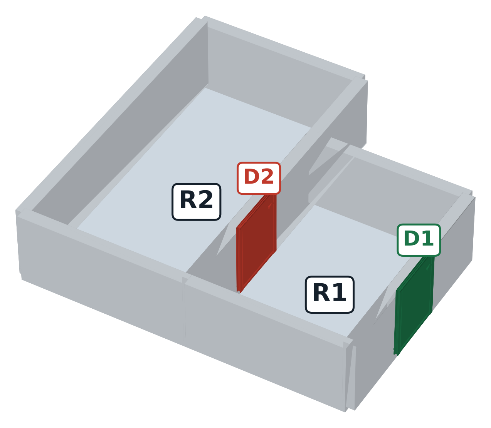
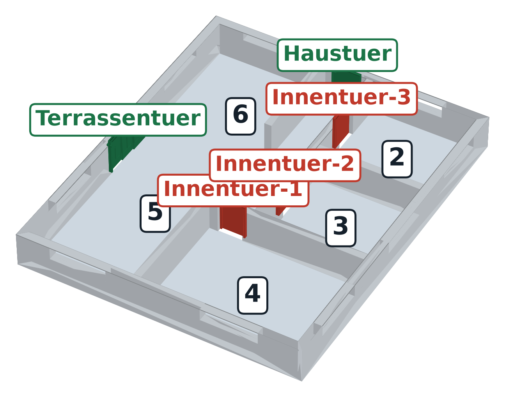

# ADA accessibility checking of IFC buildings with LLM-generated data and GNN agents

[](https://github.com/Byomer1021/ada-llm-gnn/actions/workflows/tests.yml)

**Is this building accessible to a wheelchair user, and if not, which element breaks which rule of the
2010 ADA Standards?** Given an IFC file, three graph neural network agents check the doors, the rooms and the
route from the entrance, and a main agent gives the verdict, names the violated rule and writes a report.

There was no labelled training data, so the project makes its own: a large LLM describes buildings, code writes
them to IFC, a rule engine verifies and labels every one, and a 7B model fine-tuned on the teacher's answers
generates most of the data set.

Paper: [docs/paper/main.pdf](docs/paper/main.pdf) (IEEE conference format, 6 pages).

| Synthetic test building | Public IFC model (FZK-Haus, ground floor) |
|---|---|
|  |  |
| D2 fails ADA 404.2.4 (push-side clearance 1196 mm < 1220 mm), so R2 cannot be reached | Three inner doors fail on an **estimated** clear width of 745 mm |

## Results

Measured on 336 buildings that no model saw in training (225 inaccessible, 111 accessible).

| | Result |
|---|---|
| Teacher LLM (Nemotron 3 Ultra): valid buildings | 231 / 231 |
| Student (Qwen2.5-7B + LoRA) vs. the same model untuned | **81%** vs. 4% of attempts valid; 2,013 buildings |
| Door / room / route agent, F1 of the failing class | 0.926 / 0.960 / 0.879 (3 seeds) |
| **Building verdict, macro F1** (path tracing over the agents) | **0.938** (target 0.90; majority class 0.40) |
| Same, fine-tuned 7B LLM as the main agent | 0.921 (not significantly different, p = 0.23) |
| Same, untuned 7B LLM, zero-shot / few-shot | 0.569 / 0.566 |
| 30% of the values deleted: inaccessible buildings missed | **3 / 225** (rule engine that skips unknown values: 72) |

The full tables (generation, agents, main agents, missing data, real files) are in the paper.

## How it works

```
GENERATION                                              CHECK
teacher LLM -> JSON -> IFC writer -> rule engine       IFC file -> reader (+ estimates) -> room-door graph
   (verify + label) -> student LLM (LoRA) -> 2,244     -> door / room / route GNN agents (parallel)
   labelled IFC buildings                              -> main agent -> verdict + violated rule + report
```

- **The LLM never writes IFC.** It describes the building as JSON; our code writes the file
  (IfcOpenShell). Code, not the model, fixes the layout and the values near each ADA limit, because
  independent requests make a model return the same values every time.
- **The rule engine only labels.** It verifies the generated buildings and writes the labels; the check
  itself runs on the agents.
- **Route agent on a transit graph:** a node is "entering room r through door d", an edge is "crossing r
  from one door to another" and carries the walls of both doors. Whether a room that is too small to turn in
  can be crossed straight (opposite walls) or not (adjacent walls) is then visible on a single edge.
- **Missing values:** the agents are trained with randomly deleted values, which also made them better on
  complete data.

Rules checked: door clear width (404.2.3), threshold (404.2.5), hardware height (404.2.7), maneuvering
clearance (404.2.4, simplified), turning space (304.3.1) and straight passage width (403.5.1). The limits
live in [config/ada_rules.yaml](config/ada_rules.yaml).

## Quick start

Python 3.10+.

```bash
python -m venv .venv
.venv\Scripts\activate                 # Mac/Linux: source .venv/bin/activate
pip install torch --index-url https://download.pytorch.org/whl/cpu
pip install -r requirements.txt

python -m pytest                       # 180 tests
python scripts/demo_pipeline.py        # one building: JSON -> IFC -> read -> graph -> agents -> verdict -> report
streamlit run app/streamlit_app.py     # web UI: upload an IFC file
```

The data set and the trained agents are not in the repository (size, and the public IFC models keep their
own licenses). Without trained agents, the demo and the UI use the *oracle* agents, which is the rule engine in
place of the GNNs. The oracle is only for testing. To train your own agents, see below.

## Reproduce

| Step | Command | Needs |
|---|---|---|
| Teacher buildings | `python -m src.llm.generate --role teacher --provider nemotron --n 200 --write-ifc` | NVIDIA API key |
| Student training data | `python -m src.llm.generate --export-sft` | |
| Student (LoRA) + 2,000 buildings | [notebooks/student_colab.ipynb](notebooks/student_colab.ipynb) | GPU (A100 / L4) |
| Graph data set (split by building) | `python -m src.agents.dataset` | |
| Agents | `python -m src.agents.train --agent door --drop-frac 0.2 --models-dir models/missing` (also `room`; `route --conv transit`) | CPU, minutes |
| Main agents, test split | `python scripts/evaluate.py --provider rule` | |
| Fine-tuned LLM main agent | [notebooks/main_agent_sft_colab.ipynb](notebooks/main_agent_sft_colab.ipynb) | GPU |
| Missing values (E4) | `python scripts/missing_data.py --agent-sets gnn=models gnn_aug=models/missing` | |
| Public IFC models (E5) | `python scripts/test_real_ifc.py --folder data/real` | IFC files, e.g. [ifc-bench](https://huggingface.co/datasets/sylvainHellin/ifc-bench) |

`python -m src.llm.generate --dry-run --n 50 --write-ifc` runs the whole chain without an API on fake answers,
written to separate files.

## What it cannot do

- **Only synthetic, single-storey, two-room buildings were used for training and testing.** Corridors and
  larger layouts are untested.
- **The labels come from my own rule engine**, so the agents learn my reading of the rules: doors on
  adjacent walls need a turn, ADA 404.2.4 is simplified to a front approach, and maneuvering clearance is
  bounded by the room depth. No architect has reviewed these readings.
- **On real files the verdicts are not validated.** Real exports carry no accessibility properties.
  Estimated door widths depend on what `OverallWidth` means in each exporter: the leaf in Revit 2011, the
  frame-inclusive width in Revit 2024. On 20 public models all 18 that could be checked came out
  inaccessible, mostly on estimated widths, and two files with no `IfcSpace` cannot be checked at all.
- **The fine-tuned LLM writes wrong explanations at times**, e.g. "clear width 824 mm < 815 mm". The
  rule-based path tracing is as accurate and always consistent with its explanation.
- **The fine-tuned LLM needs a GPU.** Without one, the UI uses the rule-based main agent and says so.

## Layout

```
config/       ADA limits, estimates for real files, agent / main-agent settings, LoRA settings
prompts/      generation prompts, main-agent prompt, worked examples
src/ada/      rule engine, IFC writer / reader, graph builder, report
src/llm/      teacher / student generation and verification, student training
src/agents/   data set, GNN agents (incl. transit graph), training, main agent, its training data
scripts/      demo, evaluation, missing-data experiment, real-file test
app/          Streamlit UI          tools/   3D view of an IFC file
notebooks/    Colab: student, LLM main agent, fine-tuned main agent
docs/paper/   the paper (LaTeX + PDF)
tests/        180 tests
```

## License

MIT, see [LICENSE](LICENSE). The public IFC models used in the real-file test are not included and keep their
own licenses.
